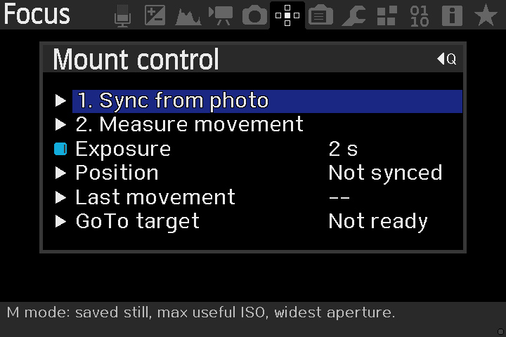

# Mount control: still-photo pointing and empirical axes

## Camera menu

`Focus -> Midnight -> Mount control`:

| Item | Effect |
|---|---|
| Sync from photo | Capture and solve a new still photo; store current J2000 RA/Dec |
| Measure movement | Capture and solve again; show east/north displacement from previous point |
| Exposure | 1 or 2 seconds (default 2) |
| Position | Last verified RA/Dec |
| Last movement | Last measured east/north displacement |
| GoTo target | **Not ready** until USB command transport and both motors are calibrated |

The measurement path does **not** use the Live View feature, its digital gain, or an amplified Live View frame. In Manual photo mode, it temporarily requests the camera's maximum *analogue* ISO, widest electronically controlled aperture (lowest f-number), and 1 or 2 second shutter. It then triggers a standard still photo without autofocus, waits for the camera file number to advance, and plate-solves the Canon saved-photo playback preview. Camera settings are restored even if capture fails. Open manual-aperture lenses physically.

The saved preview is currently trusted to be the newest photo after `enter_play_mode`. This assumption **requires real hardware validation**. Magic Lantern's camera emulator does not prove that the shutter creates a file or that playback displays the newest photo. A future motor-movement loop must verify the new image association before using the measurement.

## Planned closed-loop GoTo

The camera is the pointing sensor; the ESP32-S3 is the motor bridge.

1. Sync from a newly captured photo.
2. Probe the RA motor forward and backward. Re-solve after each safe motion.
3. Probe the secondary motor forward and backward in the same way.
4. Estimate each motor's **empirical east/north movement vector** in sky coordinates, including skew and backlash. No orthogonality assumption.
5. Convert the target offset into motor pulse durations by solving the 2x2 calibration matrix.
6. Move one axis for a bounded duration, then capture a new photo and measure the real result.
7. Update the measured motor vectors from accepted probes and repeat until the target is within tolerance. Abort on bad solves, nearly parallel axes, communication failures, excessive error or cancellation.

The pure-C `mount_model.c` already implements axis-vector estimation, RA wrap handling, non-orthogonal 2x2 inversion, bounded pulse planning and singularity checks. Its deterministic tests simulate iterative convergence.

**GoTo is intentionally disabled:** a physical Canon USB host connection is not verified, the camera-to-ESP motion command and acknowledgement channel is not implemented, and the secondary motor driver and GPIO/power wiring are not known. The existing ESP32 firmware controls the OG Star Tracker's RA motor only. No automatic motor action occurs on camera startup or after Sync.

The mount should not assume arbitrary sidereal drift subtraction. With RA tracking enabled, the before/after measured offset already includes any tracking error. Re-solving after each move is the feedback signal.
